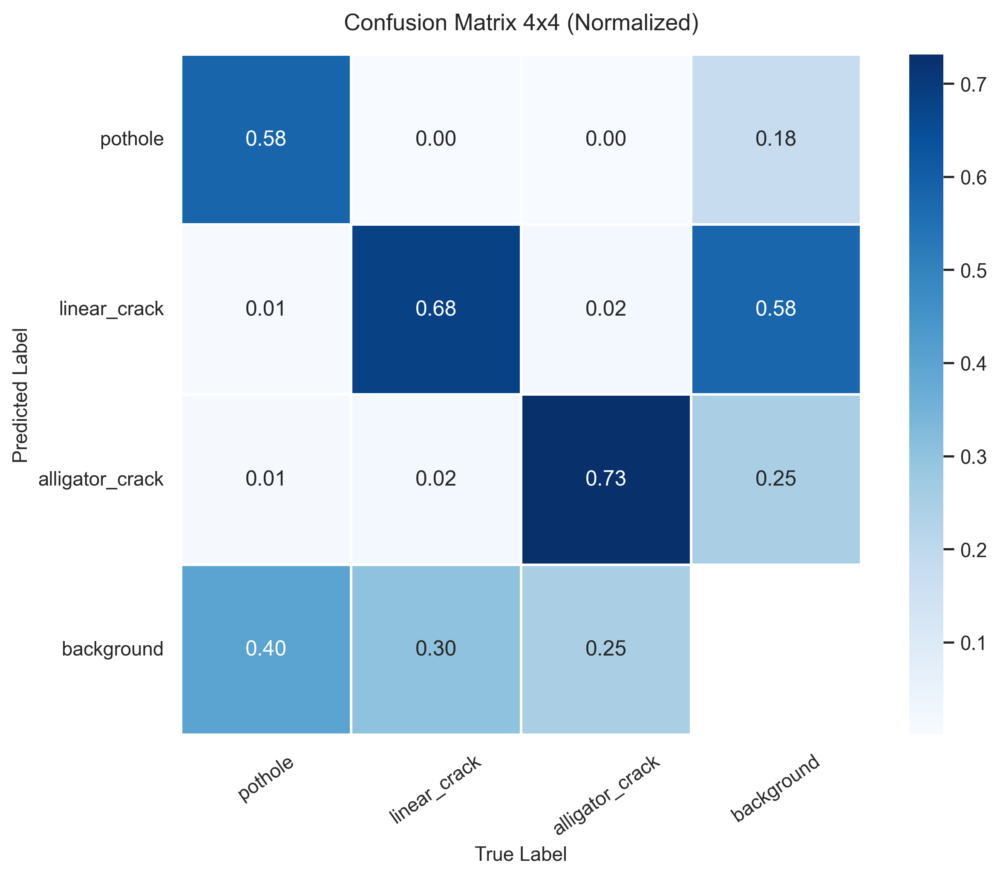
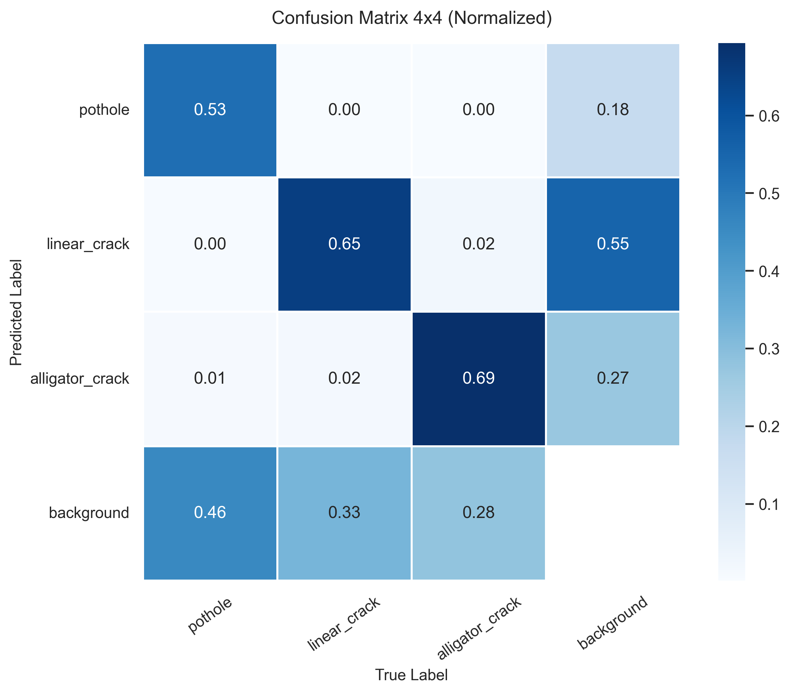
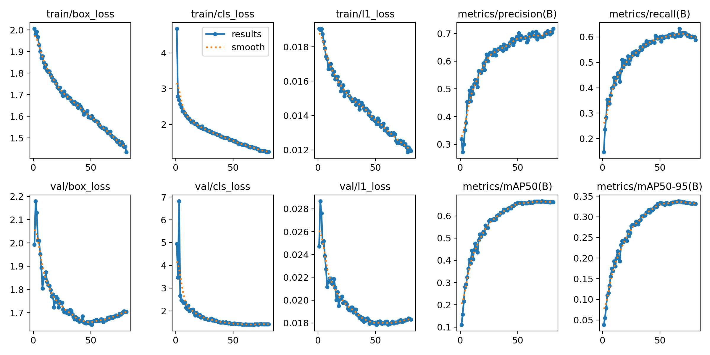
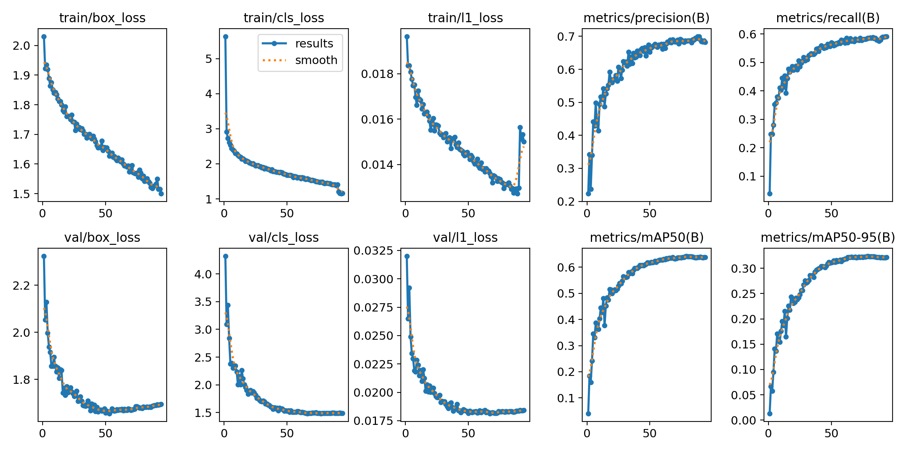

# 🛣️ Automated Road Surface Damage Detection with YOLO26

[](https://www.python.org/)
[](https://pytorch.org/)
[](https://github.com/ultralytics/ultralytics)
[-green)](https://crddc2022.sekilab.global/)
[](LICENSE)

An end-to-end deep learning framework for real-time detection and classification of road distress surfaces. This project comprehensively benchmarks a lightweight edge-optimized model (**YOLO26-Nano**) against a higher-capacity representation model (**YOLO26-Small**) across multi-national road damage scenarios.

---

## 📌 Problem Overview & Target Classes

Automated pavement distress assessment is vital for modern Intelligent Transportation Systems (ITS) and predictive infrastructure maintenance. This project focuses on **3 critical road damage categories**:

| Class ID | Damage Category | Description & Impact |
| :---: | :--- | :--- |
| **0** | **`pothole`** | Structural cavities caused by moisture penetration and traffic stress, posing immediate safety hazards. |
| **1** | **`linear_crack`** | Longitudinal and transverse cracks formed along or across the roadway alignment. |
| **2** | **`alligator_crack`** | Fatigue cracking patterns resembling reptile skin, indicating structural base failure. |

---

## 📊 Experimental Results & Benchmarking

Both models were trained under identical conditions and thoroughly evaluated on an unseen test/validation set consisting of **2,201 images** and **4,611 damage instances**.

### 1. Overall Performance Comparison

| Model | Input Size | Precision (P) | Recall (R) | **mAP@50** | **mAP@50-95** | Inference Latency | FPS (GPU) |
| :--- | :---: | :---: | :---: | :---: | :---: | :---: | :---: |
| ⚡ **YOLO26-Nano** | 640×640 | 68.6% | 58.6% | **64.32%** | **32.38%** | **3.8 ms** | **~263 FPS** |
| 🚀 **YOLO26-Small** | 640×640 | **70.8%** | **60.5%** | **66.59%** | **33.76%** | 11.1 ms | ~90 FPS |
| **Delta** | — | *+2.2%* | *+1.9%* | **+2.27%** | **+1.38%** | *-7.3 ms* | *Nano 3× faster* |

> 💡 **Architectural Trade-off Analysis:**  
> - **YOLO26-Nano**: Delivers ultra-low latency (**3.8 ms**, over 260 FPS), making it the optimal candidate for constrained edge platforms (e.g., Raspberry Pi 5, Jetson Nano, on-vehicle dashcams).
> - **YOLO26-Small**: Provides a higher semantic capacity, gaining **+2.27% mAP@50** overall, with enhanced sensitivity on challenging pothole edge boundaries.

---

### 2. Fine-grained Per-Class Breakdown

| Target Class | Instances | Metric | YOLO26-Nano | YOLO26-Small | Key Observations |
| :--- | :---: | :--- | :---: | :---: | :--- |
| **`pothole`** | 835 | Precision<br>Recall<br>**mAP@50** | 67.2%<br>48.5%<br>**55.4%** | **69.4%**<br>**51.4%**<br>**58.5%** *(+3.1%)* | **Largest gain in Small model**, significantly reducing false negatives in shallow/shadowed potholes. |
| **`linear_crack`** | 2,444 | Precision<br>Recall<br>**mAP@50** | 68.4%<br>61.6%<br>**67.3%** | **70.0%**<br>**62.6%**<br>**68.9%** *(+1.6%)* | High detection consistency along narrow, continuous crack lines across pavement types. |
| **`alligator_crack`** | 1,332 | Precision<br>Recall<br>**mAP@50** | 70.3%<br>65.8%<br>**70.2%** | **73.0%**<br>**67.5%**<br>**72.4%** *(+2.2%)* | Best overall performance among all distress types due to distinctive multi-directional textures. |

---

## 📈 Visual Analytics & Evaluation

### Confusion Matrix Comparison
Understanding inter-class predictions and background false positive distribution:

| 🚀 YOLO26-Small | ⚡ YOLO26-Nano |
| :---: | :---: |
|  |  |

### Training History & Convergence
Progression of Box Loss, Class Loss, and mAP metrics across training epochs:

| 🚀 YOLO26-Small | ⚡ YOLO26-Nano |
| :---: | :---: |
|  |  |

---

## 📂 Repository Structure

```text
├── assets/
│   ├── yolo_n/
│   │   ├── confusion_matrix.png     # Nano confusion matrix
│   │   └── results.png              # Nano training loss & metrics
│   └── yolo_s/
│       ├── confusion_matrix.png     # Small confusion matrix
│       └── results.png              # Small training loss & metrics
│
├── configs/
│   └── data.yaml                    # Dataset directories & class mapping
│
├── notebooks/
│   ├── road-damage-3-class_yolo26n.ipynb  # Full training & validation pipeline (Nano)
│   └── road-damage-3-class_yolo26s.ipynb  # Full training & validation pipeline (Small)
│
├── weights/
│   ├── yolo26n.pt                   # Pretrained / Fine-tuned Nano weights
│   └── yolo26s.pt                   # Pretrained / Fine-tuned Small weights
│
├── requirements.txt
└── README.md
